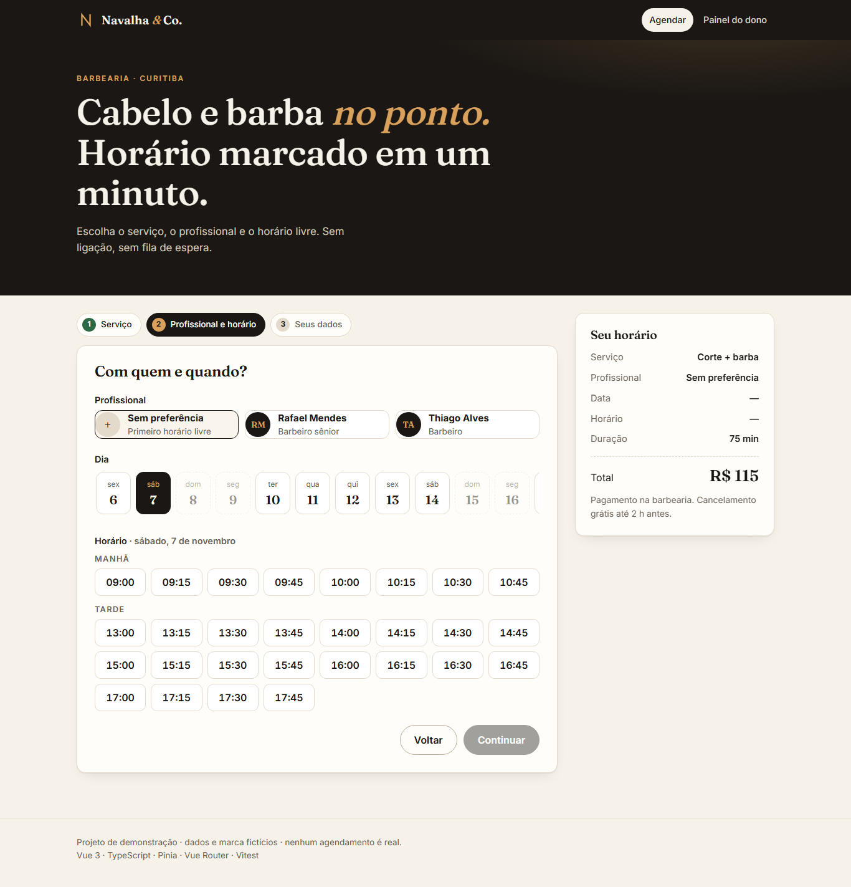
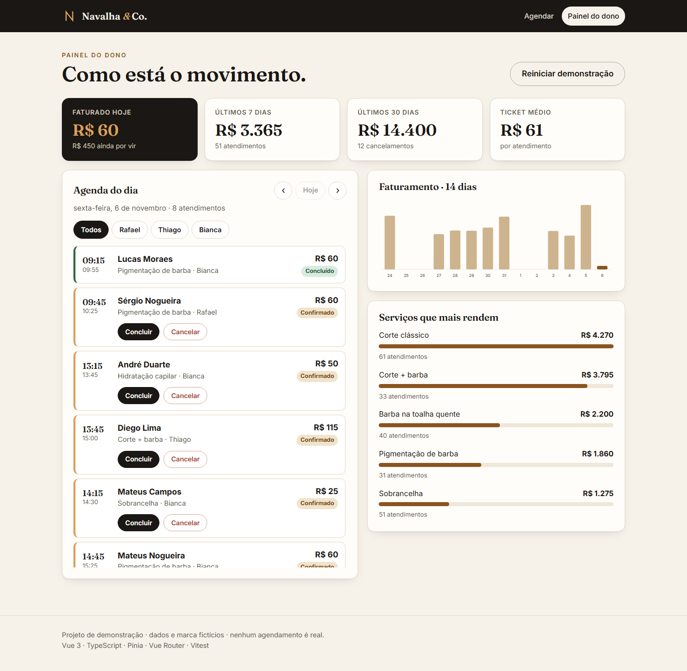
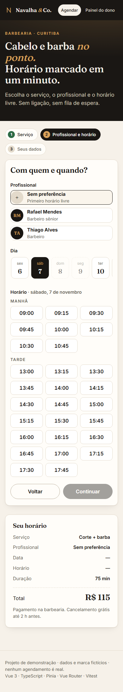
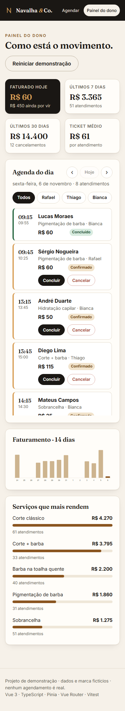
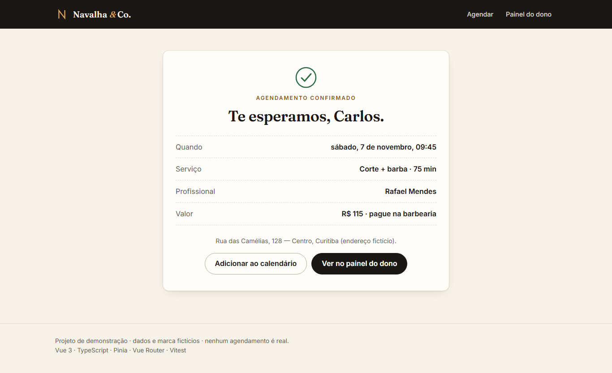

# Navalha & Co. — online booking for a barbershop

A booking app and owner dashboard for a (fictional) barbershop, built with **Vue 3 + TypeScript**.
Clients pick a service, a barber and a free time slot; the owner sees the day's agenda and revenue.

**Live demo:** https://alissonlittig.github.io/navalha-agenda/

> Demo project. Every name, price and appointment is made up. Nothing leaves the browser.

| Booking | Owner dashboard |
|---|---|
|  |  |

| Mobile booking (390 px) | Mobile dashboard | Confirmation |
|---|---|---|
|  |  |  |

## What it does

- **3-step booking:** service → barber + day + time → name and phone, with inline validation and a confirmation page (plus an `.ics` download).
- **Real availability rules:** each barber has their own days, hours and services; a lunch break; 15-minute grid; 30 minutes' notice for same-day bookings; no double booking (cancelled visits free the slot). "No preference" picks the first barber who is free.
- **Owner dashboard:** day agenda with a day navigator and a per-barber filter, mark visits as done or cancelled, KPIs (today, 7 days, 30 days, average ticket), a 14-day revenue chart (hand-written SVG) and the top-earning services.
- **Live link between both sides:** book as a client, then open the dashboard and the visit is there; cancel it and the slot is free again.
- Revenue counts only completed visits; confirmed ones show up as "still to come".
- Fake history is generated deterministically around today's date, so the demo always looks alive. State persists in `localStorage`; "Reset demo" clears it.

## Stack

Vue 3 (`<script setup>`) · TypeScript (strict) · Pinia · Vue Router (hash history, so it works on GitHub Pages) · Vite · Vitest + jsdom · GitHub Actions → GitHub Pages.
No UI kit, no chart library: plain CSS with custom properties, self-hosted variable fonts (Inter, Fraunces).

## Quality

- Lighthouse (mobile emulation, local preview): accessibility 100, best practices 100, SEO 100, performance 90–100.
- Keyboard friendly: radio groups for barbers/days/slots, visible focus rings, labelled form errors, `prefers-reduced-motion` respected.
- No horizontal scroll at 390 px.

## Structure

```
src/lib       pure logic: slots, seed data, stats, dates   (unit-tested)
src/stores    Pinia store: bookings, status overrides, persistence
src/views     BookView, ConfirmedView, DashboardView
src/components RevenueChart (SVG)
```

## Run it

```bash
npm ci
npm run dev        # http://localhost:5173/navalha-agenda/
npm test           # Vitest
npm run build      # type-check + production build
```

## Known limits

Single-tenant and client-side only: no server, no real notifications, time zone is the browser's. A real version would move `availableSlots` behind an API and enforce uniqueness in the database.
